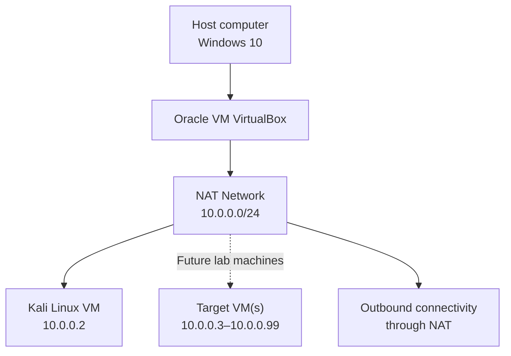
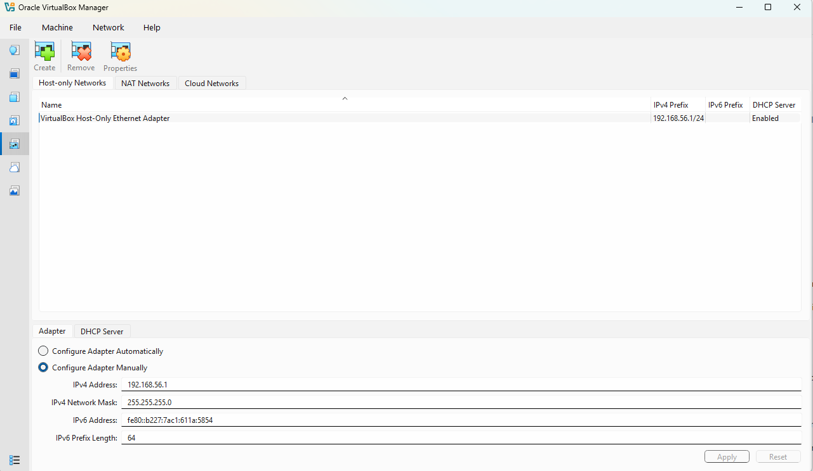

<div align="center">

# Cybersecurity Virtual Lab

### A documented, isolated environment for ethical hacking and network-security practice
## Orgernized  and Sponsered by NetWorkwalks

[](https://www.virtualbox.org/)
[](https://www.kali.org/)
[](#)
[](#)

**Build it. Isolate it. Test it. Document it.**

</div>

---

## Overview

This repository documents the deployment of a small virtual cybersecurity lab using **Oracle VM VirtualBox** and **Kali Linux**. The lab provides a repeatable environment for learning Linux administration, network troubleshooting, reconnaissance, packet analysis, and authorized security testing.

The initial setup uses a dedicated VirtualBox **NAT Network**. Additional virtual machines can later be attached to the same network to create controlled attacker-and-target exercises.

> **Safety first:** Only scan or test virtual machines and systems that you own or have explicit permission to assess. Keep intentionally vulnerable targets isolated from production and public networks.

## Contents

- [Objectives](#objectives)
- [Lab architecture](#lab-architecture)
- [Environment specification](#environment-specification)
- [Prerequisites](#prerequisites)
- [Deployment procedure](#deployment-procedure)
- [Network configuration](#network-configuration)
- [Validation checklist](#validation-checklist)
- [Troubleshooting](#troubleshooting)
- [Learning outcomes](#learning-outcomes)
- [Next steps](#next-steps)
- [References](#references)

## Objectives

- Install and configure VirtualBox.
- Import and configure a Kali Linux virtual machine.
- Create a dedicated NAT Network for lab machines.
- Configure and verify IPv4 connectivity and DNS.
- Create a clean VM snapshot for recovery.
- Record the configuration so the lab can be reproduced.
- Prepare the environment for future, authorized security exercises.

## Lab architecture



The NAT Network allows virtual machines attached to the same network to communicate with one another and, when configured, access external networks through NAT. It is different from VirtualBox's single-VM **NAT** attachment mode.

## Environment specification

| Component | Configuration |
|---|---|
| 🖥️ Host operating system | Windows 11 |
| 🧠 Host memory | 8 GB or more|
| ⚡ Processor | Intel Core i5 or upgraded version |
| 🧰 Hypervisor | Oracle VM VirtualBox 7.2 |
| 🐉 Security distribution | Kali Linux 2026.2 |
| 🧠 Kali VM memory | 2,048 MB |
| 🌐 Virtual network mode | NAT Network |
| 📡 Network name | `NatNetwork` |
| 📡 IPv4 network | `10.0.0.0/24` |
| 🐧 Kali IPv4 address | `10.0.0.2/24` |
| 🚪 Default gateway | `10.0.0.1` |
| 🌍 DNS resolver | `8.8.8.8` |
| 🔮 Planned target address range | `10.0.0.3–10.0.0.99` |

> **Configuration note:** These IP values describe the example lab. Confirm the actual gateway, DHCP range, and assigned addresses in VirtualBox before applying a static address. Ensure the static address is outside the DHCP pool or excluded from it to prevent address conflicts.

## Prerequisites

- A computer with hardware virtualization enabled (Intel VT-x or AMD-V).
- Oracle VM VirtualBox installed.
- Kali Linux VM image downloaded from the official Kali website.
- 7-Zip or another archive utility if the downloaded image is compressed.
- Sufficient disk space and memory for the virtual machine.

## Deployment procedure

### 1. Install the archive utility

Install [7-Zip](https://www.7-zip.org/) if the Kali VM package is supplied as a compressed archive. Extract the downloaded file to a suitable folder.

### 2. Install VirtualBox

Download and install [Oracle VM VirtualBox](https://www.virtualbox.org/wiki/Downloads). If the installer requests it, restart the host computer after installation.

### 3. Create the NAT Network

In VirtualBox, open **Tools → Network → NAT Networks** (the exact menu location may vary by VirtualBox version), then create a network with the following example settings:

| Setting | Value |
|---|---|
| Name | `NatNetwork` |
| IPv4 prefix | `10.0.0.0/24` |
| DHCP | Enabled initially; configure the pool to avoid static-address conflicts |
| IPv6 | Disabled for this example |

<div align="center">



<p><b>Figure 1:</b> Cybersecurity Virtual Lab - Nat configurations</p>

</div>

Attach all lab VMs that need to communicate with one another to this same NAT Network.

### 4. Import the Kali Linux VM

Download Kali from the [official Kali Linux download page](https://www.kali.org/get-kali/). Import the supplied appliance or create a VM using the downloaded virtual disk.

Example VM settings:

- **Memory:** 2,048 MB (increase if the host has sufficient available memory).
- **Network Adapter 1:** Attached to `NAT Network`.
- **Network name:** `NatNetwork`.
- **Adapter type:** Intel PRO/1000 MT Desktop, if compatible with the imported VM.

A shared folder may optionally be configured for controlled file transfer between the host and guest. Install VirtualBox Guest Additions if required by the shared-folder setup.

### 5. Configure Kali networking

First identify the active interface and connection profile:

```bash
ip -br address
ip route
nmcli connection show
```

For a simple lab, DHCP is suitable for initial connectivity testing. If a stable address is required, configure a static address using NetworkManager and the actual connection profile name.

Example only — verify the gateway and ensure `10.0.0.2` is not inside the DHCP allocation pool before applying:

```bash
sudo nmcli connection modify "Wired connection 1" \
  ipv4.method manual \
  ipv4.addresses 10.0.0.2/24 \
  ipv4.gateway 10.0.0.1 \
  ipv4.dns 8.8.8.8

sudo nmcli connection up "Wired connection 1"
```

If your connection profile has a different name, replace `Wired connection 1` with the name shown by `nmcli connection show`.

To return the profile to DHCP:

```bash
sudo nmcli connection modify "Wired connection 1" ipv4.method auto
sudo nmcli connection up "Wired connection 1"
```

### 6. Create a clean snapshot

After confirming that the VM boots and networking works, shut down or snapshot the VM and create a baseline snapshot.

Suggested name:

```text
Clean Kali - Network Baseline
```

Create additional snapshots before major configuration changes or risky experiments. A snapshot is a recovery point, not a substitute for backing up important files.

## Network configuration

Example logical addressing plan:

| Device | Example address | Purpose |
|---|---:|---|
| Virtual NAT gateway | `10.0.0.1` | Gateway shown in this lab example |
| Kali Linux | `10.0.0.2/24` | Security workstation |
| Future target VM 1 | `10.0.0.3/24` | Practice target |
| Future target VM 2 | `10.0.0.4/24` | Additional practice target |
| Reserved planning range | `10.0.0.3–10.0.0.99` | Future lab devices |

The gateway address and DHCP behaviour can vary with the NAT Network configuration. Treat the table as the intended example plan, not a guarantee of VirtualBox defaults.

## Validation checklist

Run the following checks inside Kali Linux after connecting the VM to `NatNetwork`.

| Test | Command | What to confirm |
|---|---|---|
| IP configuration | `ip -br address` | Expected interface address is present |
| Routing | `ip route` | Default route uses the configured gateway |
| Gateway reachability | `ping -c 4 10.0.0.1` | Replies, if ICMP is permitted |
| External IP connectivity | `ping -c 4 8.8.8.8` | Replies, if ICMP is permitted |
| DNS resolution | `getent hosts kali.org` | A DNS result is returned |
| DNS diagnostic | `nslookup kali.org` | Name resolves through configured DNS |
| Nmap installation | `nmap --version` | Installed version is displayed |

**Important:** A failed ping does not always mean the network is unavailable; ICMP may be filtered. Use route checks and DNS/HTTPS tests as additional evidence. Do not publish private keys, passwords, tokens, or sensitive network details in screenshots.

## Troubleshooting

### No internet access after setting a static IP

1. Check the active connection name:

   ```bash
   nmcli connection show --active
   ```

2. Check the IP address and routing table:

   ```bash
   ip -br address
   ip route
   ```

3. Confirm that the gateway belongs to the configured NAT Network.
4. Check that the static IP does not conflict with the DHCP pool or another VM.
5. Verify DNS separately:

   ```bash
   resolvectl status
   getent hosts kali.org
   ```

6. If needed, temporarily return the connection to DHCP and test again.

Avoid applying random NetworkManager workarounds without checking the active profile and the actual error message. The command `ipv4.dad-timeout` is not a general fix for missing internet connectivity.

### VirtualBox reports a VT-x / AMD-V error

1. Restart the host computer.
2. Enter BIOS/UEFI setup.
3. Enable the processor's hardware-virtualization feature (Intel VT-x or AMD-V/SVM).
4. Save the firmware settings and restart.
5. Check the host operating system's virtualization configuration if the error remains.

On Windows, Hyper-V or other hypervisor-based security features can affect VirtualBox behaviour depending on the VirtualBox version and host configuration. Review the relevant VirtualBox documentation before changing those settings.

### VMs cannot communicate with each other

- Confirm that each VM is attached to the same **NAT Network**, not separate NAT instances.
- Confirm that each VM has a unique IP address in the same subnet.
- Check the guest firewall rules.
- Verify the NAT Network's DHCP and IPv4 prefix settings.

## Learning outcomes

This setup provides practical experience with:

1. **Virtualization:** creating and managing isolated guest systems.
2. **Virtual networking:** understanding NAT versus NAT Network.
3. **IPv4 configuration:** working with addresses, subnet masks, gateways, and DNS.
4. **Linux administration:** using tools such as `ip`, `nmcli`, and `nslookup`.
5. **Recovery planning:** using snapshots to return to a known-good state.
6. **Technical documentation:** recording setup steps, tests, and troubleshooting decisions.

## Next steps

The environment can be extended with additional lab machines and exercises, for example:

- Add an intentionally vulnerable target VM such as OWASP Broken Web Applications or Metasploitable, keeping it isolated.
- Capture lab traffic with Wireshark.
- Practise host discovery and port scanning against the lab targets only.
- Set up a small web application security-testing environment.
- Document each exercise with scope, commands, observations, and remediation notes.

## Repository structure

A suggested structure for keeping the project maintainable:

```text
cybersecurity-virtual-lab/
├── README.md
├── docs/
│   ├── network-plan.md
│   └── troubleshooting.md
├── screenshots/
│   ├── virtualbox-network.png
│   ├── kali-vm-settings.png
│   └── kali-network-test.png
└── notes/
    └── lab-observations.md
```

Add your own screenshots to `screenshots/` and update the filenames in this README when you commit them. Do not commit VM disk images, exported appliances, passwords, or private credentials.

## References

- [Oracle VM VirtualBox — Downloads](https://www.virtualbox.org/wiki/Downloads)
- [Oracle VM VirtualBox — User Manual](https://www.virtualbox.org/manual/)
- [Kali Linux — Get Kali](https://www.kali.org/get-kali/)
- [Kali Linux Documentation](https://www.kali.org/docs/)
- [7-Zip — Downloads](https://www.7-zip.org/)

---

# 👤 Author

**Flash Amenkey**\
Cybersecurity Professional B084

LinkedIn: [https://www.linkedin.com/in/flash-amenkey-a82a0b15b/)

## Orgernized and Sponsered by NetWorkwalks
---

<div align="center">

**Built for learning, experimentation, and responsible security practice.**

</div>

